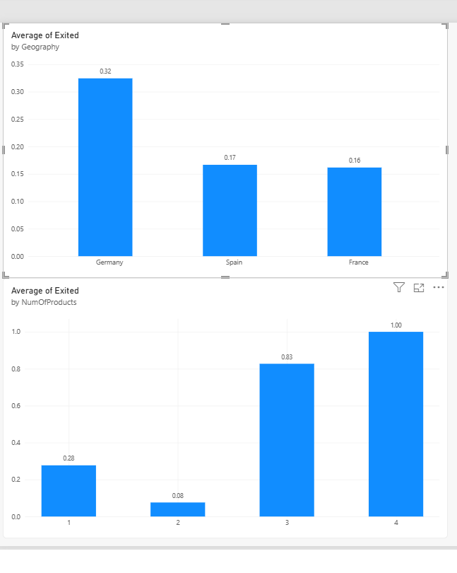

# AI-Assisted Customer Churn Analysis

A beginner-friendly analytics project where I used an AI assistant (Claude) to explore a bank's customer data faster, and then **checked every finding myself with SQL and Power BI**.

## Goal
Find out which groups of bank customers are most likely to leave (churn), and be honest about what the data can and cannot tell us.

## Data
- Bank Customer Churn dataset from Kaggle: 10,000 customers, 18 columns.
- No missing values and no duplicate rows or customer IDs.
- Overall, 20.4% of customers left (2,038 of 10,000).

## Tools
- **Claude (AI assistant):** data quality check, exploring patterns, drafting recommendations
- **SQL Server (SSMS):** verifying every AI finding with my own queries
- **Power BI:** dashboard charts
- **GitHub:** project documentation

## How I used AI (and how I checked it)
1. I uploaded the dataset and asked Claude to check data quality and find patterns.
2. I re-ran every finding with my own SQL queries (see `verification.sql`). All 7 checks matched.
3. I asked two follow-up questions and saved the questions and answers in `ai-prompts.txt`.
4. I rebuilt two of the findings as Power BI charts, which matched my SQL results.

One problem along the way: my first SQL query failed because the `Exited` column was stored as a bit type. I fixed it by converting it with `CAST(Exited AS INT)`.

## Key findings (all verified with SQL)
| Finding | Result |
|---|---|
| Overall churn | 20.4% |
| Germany vs. France / Spain | 32.4% vs. 16.2% / 16.7% |
| Customers aged 41-50 | 34.0% churn |
| Customers aged 51-60 | 56.2% churn |
| Customers aged 18-30 | 7.5% churn |
| 1 product / 2 products | 27.7% / 7.6% churn |
| 3-4 products (326 customers) | 85.9% churn |

- Germany's churn is higher in **every age group**, so age does not explain it.
- Customers with 3 or 4 products are rare but almost always leave.
- Inactive members churn more than active ones (26.9% vs. 14.3%).

## Dashboard

## Recommendations
1. **Investigate Germany first.** Its churn is about double France and Spain and is higher in every age group. The bank should look into local causes such as competitors, service, or pricing before taking action.
2. **Check what happens to customers with 3 or 4 products.** Only 326 customers hold that many products, but 85.9% of them left. The bank should find out why before encouraging customers to add more products.
3. **Focus retention efforts on customers aged 41 to 60.** Churn is 34.0% for ages 41-50 and 56.2% for ages 51-60, far above younger customers.

## Limitations (what this analysis cannot tell us)
- **Complain column:** 99.5% of customers who complained left. This is so close to a perfect match that the complaint may have been recorded after the decision to leave, so I did not use it to explain churn.
- **Satisfaction Score:** churn is about 20% at every satisfaction level, so this score does not help explain churn in this dataset.
- **Zero balances:** no customer in Germany has a zero balance, while about 48% in France and Spain do. This could be a real difference or a feature of how the dataset was made.
- **The data shows where customers leave, not why.** My recommendations are starting points for investigation, not proven solutions.
- This is one public dataset, so the results may not apply to a real bank.
- I did not build any machine learning model.

## Files in this project
- `data/Customer-Churn-Records.csv`: dataset
- `verification.sql`: SQL queries used to check the AI's findings
- `ai-prompts.txt`: my questions to the AI and its answers
- `ai_churn_dashboard.pbix`: Power BI file
- `screenshots/ai_churn_dashboard.png`: dashboard screenshot